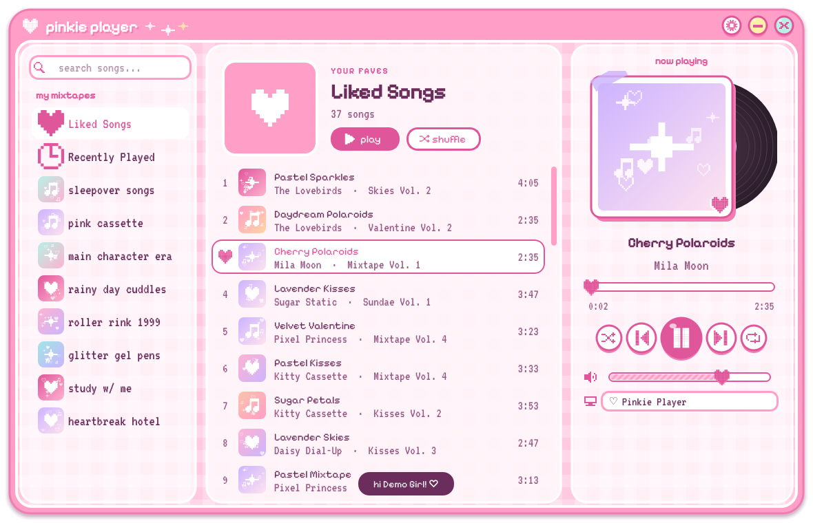

# ✨ Aayusha's Music Player 🦦 ✨

A cute, retro, pixel-style **desktop** music player made for Aayusha, for her **Spotify
Premium** account. Lavender-and-pink holographic look, a spinning CD and cassette, her
playlists, an UP NEXT notebook, a heartbeat screen, a floating Mini-Player, and an otter
pal who says sweet things. **The music plays straight out of your computer's speakers or
headphones.** You don't need the Spotify app, a phone or a browser tab to play music.



**Not a web app and not Chrome-based.** It's a native Qt app written in Python. It
installs only `PySide6-Essentials`, which doesn't include Qt's browser engine
(QtWebEngine/Chromium) at all.

## How it plays music

Spotify's public API doesn't hand audio to apps, so the app runs a **built-in speaker**
quietly in the background and plays every song through it. Music comes straight out of
the computer's speakers or headphones. No Spotify window, phone or browser tab is
involved in playback. There are two speaker engines:

1. **Spotify Soloist (recommended).** [Soloist](https://developer.spotify.com/documentation/soloist)
   is Spotify's own official player with no window (Apple Silicon Macs, 64-bit Windows,
   Linux). It works on every Premium account. Spotify doesn't allow apps to bundle it, so
   it's downloaded from Spotify with one click in Settings.
2. **librespot (backup).** [librespot](https://github.com/librespot-org/librespot) is an
   open-source player that ships inside the app. **Spotify now refuses it the song keys
   for many accounts, mostly newer ones** (the log says `error audio key 0 1`, see
   [librespot#1649](https://github.com/librespot-org/librespot/issues/1649)). When that
   happens the app stops librespot and switches to Soloist automatically.

The speaker pill under the volume slider shows its status: a **mint light** means music
comes out of your speakers. If you start music on your phone, the pill says so. Tap it to
**bring the music back** to the computer.

## Features

- **Made for Aayusha:** her name in the title, greetings, an otter pal 🦦 with little
  notes (tap it for hearts), and an otter that swims along the progress bar. The 🦦 is
  drawn with the computer's own emoji font, so on her Mac it's Apple's otter
- **Mini-Player** (title bar button or Ctrl+M): a tiny window with the cover, title, time,
  shuffle, previous, heart play/pause, next, repeat and volume. It stays on top, remembers
  where she put it and whether it was open, and pops up by itself when the big window is
  minimized. **Right-click it** to switch between the *classic* and *cassette* (spinning
  reels) styles, or to turn "always on top" / "pop up when minimized" off. Space, ← and →
  work while it's focused; scroll over it to change the volume
- **Media keys (Mac):** the keyboard's ⏯ ⏭ ⏮ keys, AirPods/headphone taps, and the
  Control Center / menu-bar **Now Playing** widget (with the album cover) all control the
  app. Not on Windows/Linux yet
- **Instant updates with Soloist:** song changes, pause, seek, volume and the queue arrive
  live from Soloist, so the screen reacts immediately; Spotify is only checked every 15 s
  as a backup
- **UP NEXT** notebook showing Spotify's queue (double-click to jump to a song)
- **Favorites:** right-click a playlist → "add to favorites" pins it in its own section

- Holographic "screen" with a spinning CD, the album cover and a cassette whose reels turn
- LCD marquee with ARTIST - TITLE (YEAR), a big glossy heart play button
- Sidebar: MY LIBRARY, DISCOVER, FAVORITES and PLAYLISTS with cover art
- Song list on notebook paper. Double-click a song (or press Enter) to play it
- 320 kbps playback with volume levelling
- Search (Ctrl+F)
- Keyboard: **Space** play/pause · **Ctrl+→** next · **Ctrl+←** previous ·
  **Ctrl+M** mini-player · **Ctrl+Q** quit
- `--demo` mode to preview the whole app with made-up music, no account needed

## Setup

### Step 1: Create your free Spotify developer app (2 minutes, everyone)
Spotify requires every app to have a **Client ID**:

1. Go to the [Spotify Developer Dashboard](https://developer.spotify.com/dashboard) and log in
   with your **Premium** account.
2. Click **Create app**. Use any name and description, e.g. "Aayusha's Music Player".
3. Under **Redirect URIs** add exactly:
   ```
   http://127.0.0.1:8898/callback
   ```
   Use `127.0.0.1`, not `localhost`. Spotify rejects `localhost`.
4. Under "Which API/SDKs are you planning to use?" tick **Web API**, accept the terms, **Save**.
5. Open the app's **Settings** and copy the **Client ID**. You don't need the client secret.

### Step 2, option A: Download the ready-made app (easiest)
No GitHub account needed:

1. Open **[the latest release](https://github.com/Jalym4n/musicplayer/releases/latest)**.
2. Under **Assets**, download `AayushaMusicPlayer-macOS.zip`, `AayushaMusicPlayer-Windows.zip`
   or `AayushaMusicPlayer-Linux.tar.gz` and unzip it.
3. Open it:
   - **Windows:** run `Aayusha's Music Player.exe` inside the folder. If SmartScreen warns, click
     **More info → Run anyway**.
   - **macOS:** drag **Aayusha's Music Player.app** to Applications. The app isn't signed by Apple,
     so run this once in Terminal:
     ```bash
     xattr -dr com.apple.quarantine "/Applications/Aayusha's Music Player.app"
     ```
   - **Linux:** run `Aayusha's Music Player` inside the folder.

### Step 2, option B: Run from source
1. Install **Python 3.10+** ([python.org](https://www.python.org/downloads/); on Windows tick
   **"Add Python to PATH"**) and **Rust** ([rustup.rs](https://rustup.rs), for building the speaker).
   On Linux, also run `sudo apt install libasound2-dev pkg-config`.
2. Get the code and install:
   ```bash
   git clone https://github.com/Jalym4n/musicplayer.git
   ```
   ```bash
   cd musicplayer
   ```
   ```bash
   python -m pip install -r requirements.txt
   ```
3. Build the speaker once (takes a few minutes):
   ```bash
   python scripts/build_librespot.py
   ```
4. Start the app:
   ```bash
   python -m pinkie
   ```
   (On macOS/Linux use `python3` if `python` isn't found.)

To build your own double-click app instead, run
`python -m pip install -r requirements-dev.txt` and then `python scripts/build.py`. The
result goes in `dist/`.

### Step 3: First launch
1. Paste your **Client ID** into the setup window and click **let's go!**
2. Your browser opens the Spotify login. Approve it and close the tab.
3. Set up the speaker (Spotify Soloist), once:
   1. Open **Settings (gear) → get my key**. Log in with the same Premium account and
      create a **Soloist key** on that page. Copy it into the **Soloist key** box.
   2. Click **download Soloist from Spotify**. It fetches Spotify's official build.
      (Homebrew also works: `brew install --cask spotify-soloist`.)
   3. Click **save**. The speaker pill says **pair once from your phone**.
   4. On a phone on the **same Wi-Fi**, open Spotify → tap the devices icon → pick
      **Aayusha's Player**. The pill turns **mint**. You never need the phone again.
4. Pick a playlist and press play ♡

You stay logged in after that, so later launches go straight to your music.

**Soloist updates:** Spotify's Soloist builds stop working 90 days after they're made.
When that happens the pill says the build expired. Open Settings → **update Soloist**.

**Publishing a new release** (after changes): bump `__version__` in `pinkie/__init__.py`
(e.g. `1.1.0`) and push a commit whose message contains `[release]`. Or: repo → **Actions** →
**Build Aayusha's Music Player** → **Run workflow** with a tag like `v1.1.0`.
(Every push also builds test copies under that run's **Artifacts**, for signed-in users.)

## Personalizing

- **Her name:** Settings (gear) → "who's this player for?". It updates the title, the
  greetings and the speaker's name in Spotify.
- **The otter's notes:** edit `NOTES` in `pinkie/personal.py`, then rebuild (or push, and
  GitHub builds new apps).

## Spotify's rules for personal apps (2026)

Your Client ID runs in Spotify's **Development Mode**, which is meant for personal projects:

- The **app owner must have Premium**, and playback only works with Premium.
- Up to **5 users** can be added to one app (Dashboard → your app → **User Management**).
  You're included automatically as the owner.
- Spotify only lets apps read the **song list of playlists you created or collaborate on**.
  Playlists you follow still show up with their cover and the **play** button works, but
  their songs aren't listed.
- Search returns 10 results per request, so the app fetches up to 3 pages.

## Troubleshooting

| Problem | Fix |
|---|---|
| "INVALID_CLIENT: Invalid redirect URI" in the browser | The redirect URI in the dashboard must be exactly `http://127.0.0.1:8898/callback` |
| "Port 8898 is busy" | Close other copies of the app and try again |
| Speaker pill says **speaker setup needed** | Do the Soloist setup in Step 3 (key + download) |
| Speaker pill says **pair once from your phone** | Phone on the same Wi-Fi → Spotify → devices icon → **Aayusha's Player** |
| Log shows `error audio key 0 1` | Spotify blocks librespot for this account. Set up Soloist (Step 3); the app switches by itself |
| Pill says the Soloist build **expired** | Settings → **update Soloist** |
| Media keys control Apple Music / Spotify instead | Quit those apps (macOS sends the keys to whichever app last played), then press play in the app once |
| Speaker panel says **no sound output found** | Plug in or switch on speakers/headphones, then tap the panel to restart the speaker |
| Speaker panel says **speaker login** | Finish the Spotify tab that opened. Tap the panel to open it again |
| Speaker panel shows **speaker trouble**, or keeps saying "warming up" / "restarting" | Settings (gear) → **reset speaker login**, then approve the Spotify tab. Still stuck? Settings → **open speaker log** and send the last 30 lines |
| macOS says the app or `librespot` "can't be opened" | Run the `xattr` command from Step 2A |
| "Playback control needs Spotify Premium" | The logged-in account isn't Premium |
| "asking too often" | Spotify's rate limit. Wait a minute |
| A playlist says its songs are private | Spotify blocks listing songs of playlists you don't own. Press **play** anyway |
| Want to switch accounts | Settings (gear) → **log out**, then reopen the app |

`python -m pinkie --check-speaker` prints where the app found its speaker.

Settings, your login token and the speaker's saved login are stored only on your computer:
`%APPDATA%\Pinkie Player` (Windows), `~/Library/Application Support/Pinkie Player` (macOS),
`~/.config/pinkie-player` (Linux).

## Project layout

```
pinkie/
  app.py            entry point (python -m pinkie)
  personal.py       her name + the otter's sweet notes
  main_window.py    window + logic tying the UI to Spotify
  speaker.py        librespot speaker: runs it, handles its login and restarts
  soloist.py        Spotify Soloist speaker: download from Spotify, pairing, live events
  nowplaying.py     media keys + macOS Now Playing widget
  auth.py           Spotify PKCE login (no client secret) + token refresh
  spotify.py        Web API client (2026 Development Mode endpoints)
  demo.py           offline fake Spotify for --demo
  images.py         album cover download + cache
  theme.py          palette, stylesheet, pixel icons
  widgets/          deck (CD/cassette screen), sidebar, notebook, mini-player, dialogs
  assets/fonts/     Pixelify Sans + VT323 (SIL Open Font License)
scripts/
  build_librespot.py  compiles the speaker (librespot 0.8.0) into pinkie/bin/
  build.py            builds the double-click app with the speaker bundled
.github/workflows/build.yml   Windows/macOS/Linux builds on every push
tests/              python -m pytest
```

Fonts: [Pixelify Sans](https://github.com/eifetx/Pixelify-Sans) and VT323, both under the
SIL Open Font License (license files in `pinkie/assets/fonts`). librespot is MIT licensed.
